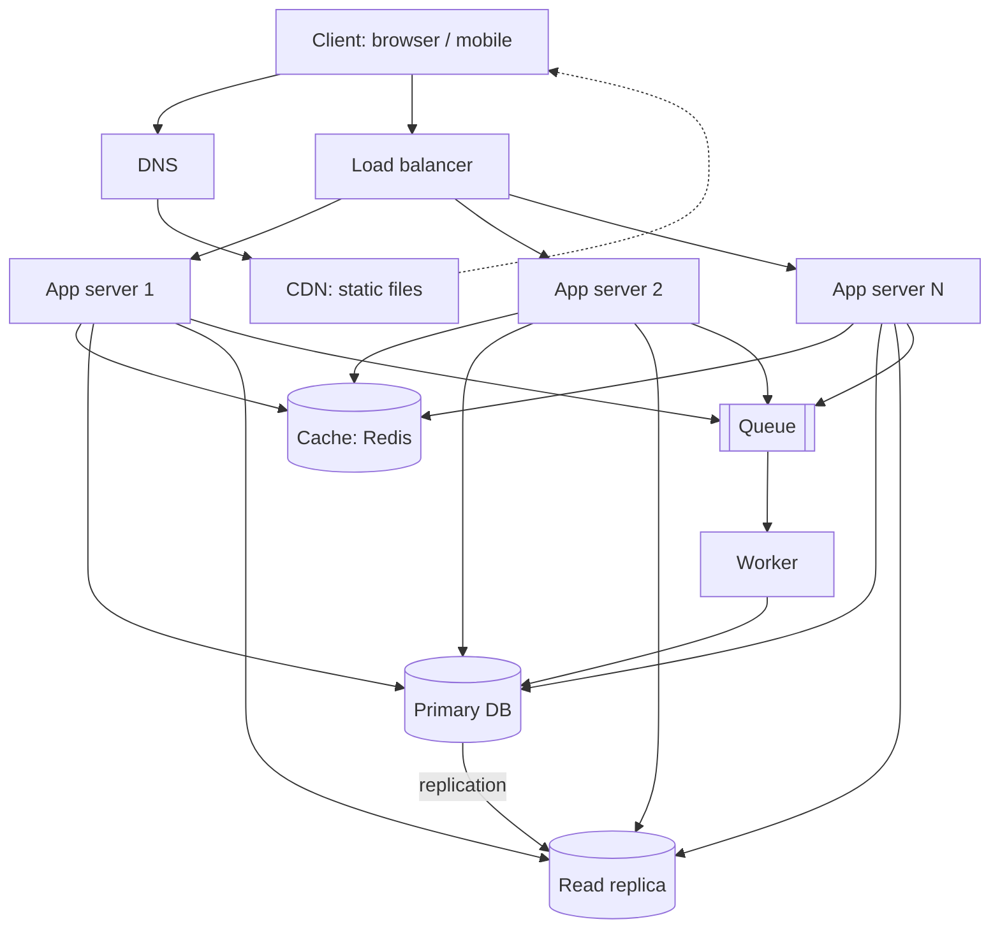

# QuickNotes Architecture (1 million users)

## Requirements

**Functional:** register and log in; create, read, update and delete notes; tag notes; list and filter notes; see only your own notes.

**Non-functional:** availability 99.9%; p95 latency under 300 ms for reads; durability (no lost notes); security (HTTPS, hashed passwords, per-user access control); horizontal scalability; reads far outnumber writes (about 4:1).

## Load estimate

Assumptions: 1M registered users, 20% active daily (200,000 DAU), each reads notes 20 times and writes 5 times per day, peak traffic is 10x the average, average note is about 1 KB.

| Metric        | Calculation            | Result                                   |
| ------------- | ---------------------- | ---------------------------------------- |
| Reads/day     | 200,000 × 20           | 4,000,000                                |
| Reads/second  | 4,000,000 / 86,400     | about 46 avg, about 460 peak             |
| Writes/day    | 200,000 × 5            | 1,000,000                                |
| Writes/second | 1,000,000 / 86,400     | about 12 avg, about 120 peak             |
| Storage/year  | 1,000,000 × 365 × 1 KB | about 365 GB (about 0.5 TB with indexes) |

This fits comfortably on one primary database plus a replica, and the app tier scales horizontally for peaks.

## Diagram

## Components

- **Client:** shows the UI and calls the REST API.
- **DNS:** turns `quicknotes.example` into the address of the load balancer or CDN, so users need no IP addresses.
- **CDN:** serves HTML, CSS and JS from servers near the user, cutting latency and load on our servers.
- **Load balancer:** spreads requests across app servers and stops sending traffic to unhealthy ones.
- **App servers (2+):** run the stateless API logic, so we can add more servers as load grows.
- **Cache (Redis):** keeps hot results such as each user's latest notes in memory, so most reads skip the database.
- **Primary database:** the single source of truth that accepts all writes.
- **Read replica:** serves read queries and offloads the primary; it is also a hot standby.
- **Queue:** holds background jobs so slow work never delays the user's request.
- **Worker:** processes queue jobs such as search indexing, email notifications and cache warming.

## Request flows

**GET /notes**

1. The client sends `GET /notes` with its token; DNS resolves the host.
2. The load balancer picks a healthy app server.
3. The app server validates the token and finds the user id.
4. It checks the cache for `notes:user:{id}:page:1`.
5. Cache hit: return the JSON immediately.
6. Cache miss: query the read replica, store the result in the cache with a TTL of 60 s, and return it with `200 OK`.

**POST /notes**

1. The client sends `POST /notes` with JSON; the load balancer picks an app server.
2. The app server authenticates and validates the body (title required, at most 100 characters), returning `400` if invalid.
3. It inserts the note into the primary database.
4. It invalidates the user's cached note lists.
5. It puts a job on the queue (index the note, send notifications).
6. It returns `201 Created` with the note; the worker handles the job in the background and the replica receives the row via replication.

## Trade-offs

1. **Cache vs consistency:** the cache and replica make reads fast and cheap, but a user may briefly see stale data (replication lag, TTL). We invalidate the user's cache on writes and can read from the primary right after a write ("read your own writes").
2. **Queue vs simplicity:** the queue keeps POST fast and absorbs spikes, but adds another component, retries and eventual consistency for background work. Jobs must be idempotent.
3. **SQL single primary vs sharding:** one primary is simple and consistent, but writes cannot scale beyond it; at this load that is fine and sharding by `user_id` is the later option.

## Avoiding single points of failure

- Two or more app servers behind a redundant (multi-zone) load balancer; stateless servers can be replaced at any time.
- Primary DB with automatic failover: the replica is promoted if the primary dies, plus daily backups.
- Redis runs with a replica, and the app still works (slower) straight from the database if the cache is down.
- The queue is replicated and workers run as several instances; failed jobs are retried.
- DNS and CDN are managed multi-region services; the deployment spans at least two availability zones.
